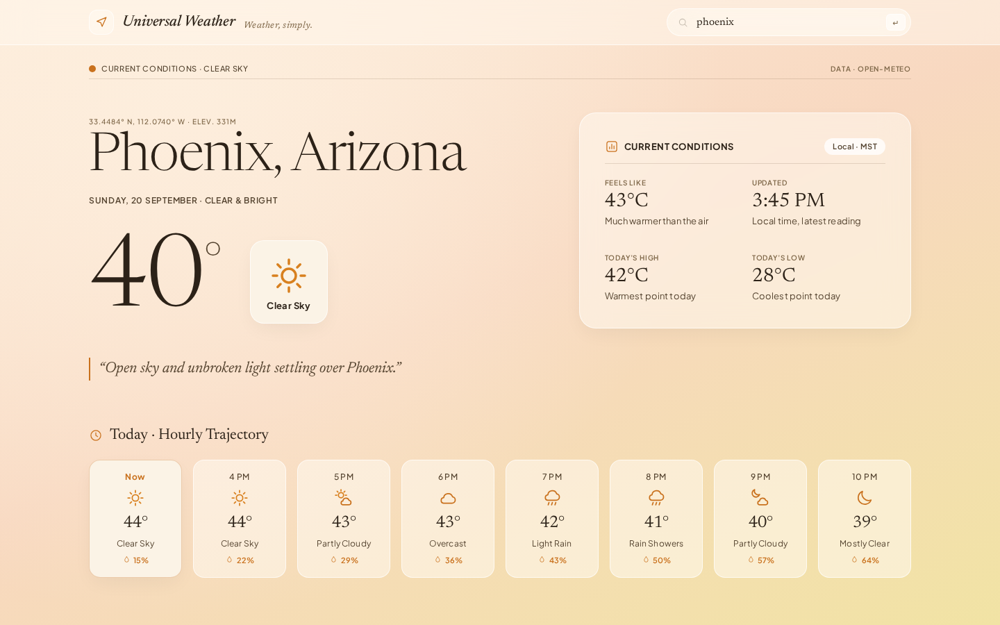
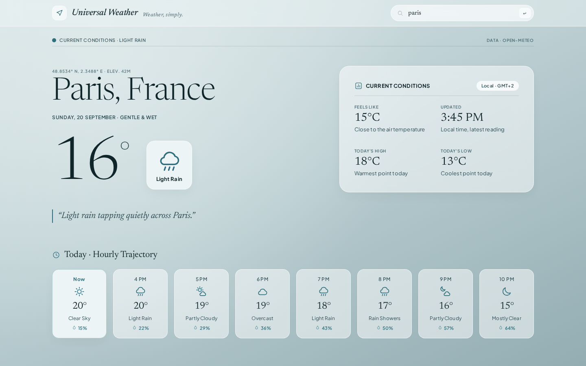
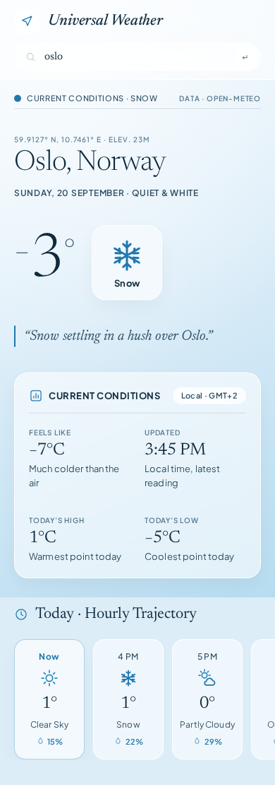

# Universal Weather

A minimal, design-led weather search app. Type a city, see its current conditions and the next eight hours. Built with plain HTML, CSS and vanilla JavaScript — no frameworks, no build step, no API key.

## Features
- Search any city (add a hint like `Paris, Texas` to disambiguate)
- Current temperature, feels-like, today's high/low, local time
- Eight-hour hourly strip with condition and rain chance
- Six weather-driven colour themes: sunny, partly cloudy, cloudy, rain, storm, snow
- Responsive on desktop, tablet and mobile
- Graceful handling of unknown cities and network failures

## Run it
Open `index.html` in a browser (internet needed for fonts and weather data), or use the VS Code **Live Server** extension.

## Tech
HTML5 · CSS custom properties · vanilla JS · [Open-Meteo](https://open-meteo.com/) geocoding + forecast APIs · Google Fonts (Newsreader, Plus Jakarta Sans)

## Screenshots
| Rain | Snow (mobile) |
|---|---|
|  |  |

## Credits
Weather data by [Open-Meteo](https://open-meteo.com/) (CC BY 4.0). Visual design based on a Stitch-generated "Atmospheric Serenity" design system.
